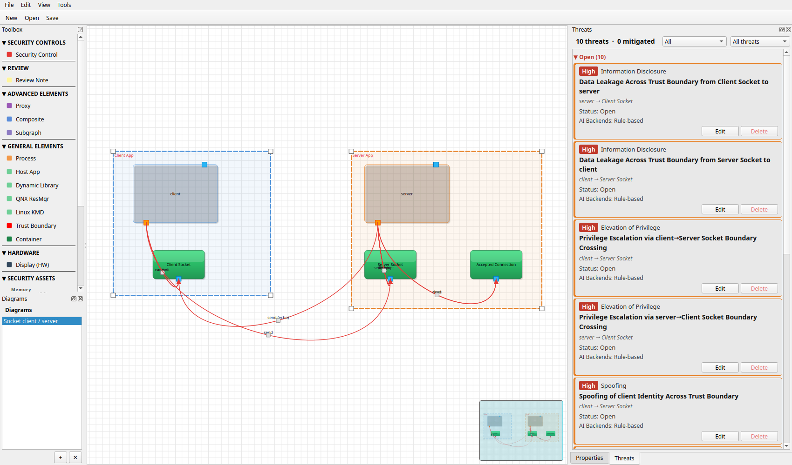
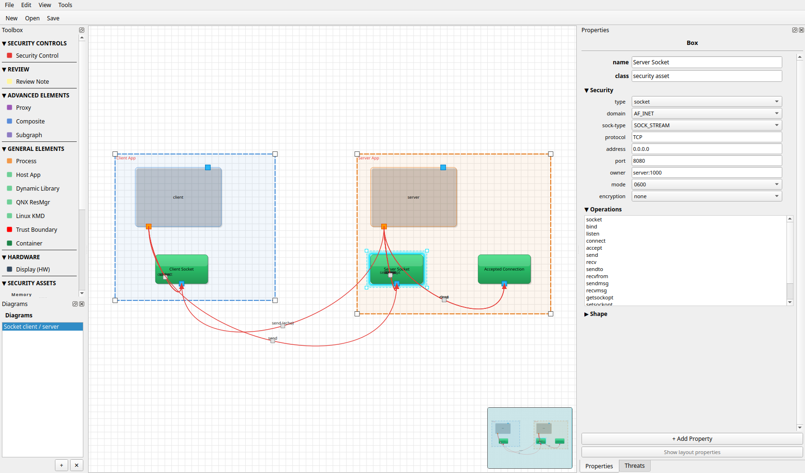
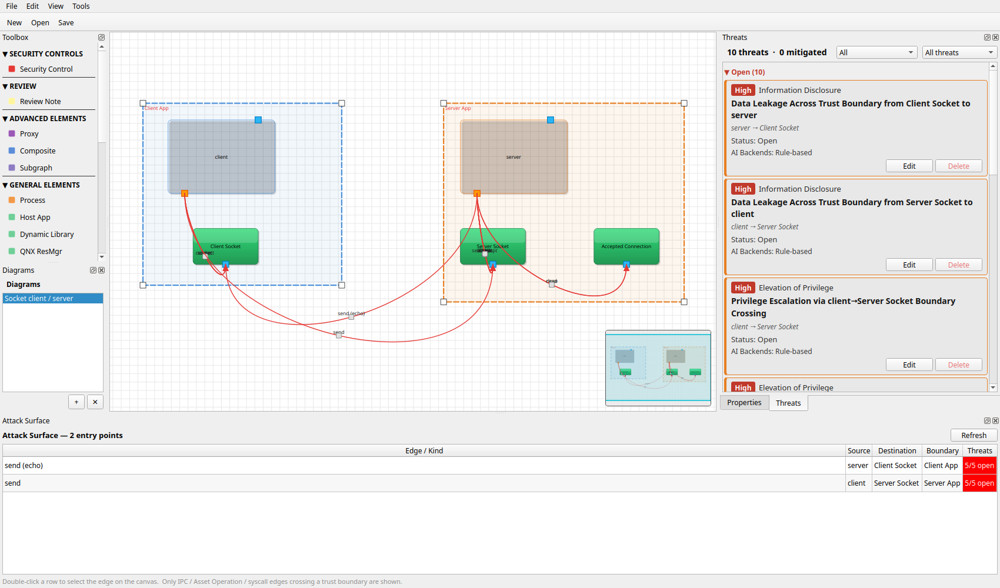

# ThreatTrace

ThreatTrace is a desktop **security threat modelling tool** for embedded, driver and
RTOS-style software stacks (Linux, QNX, …). You draw a system's processes, assets, trust
boundaries and data flows; ThreatTrace generates, scores and tracks threats directly on
the diagram, links each one to the mitigations that cover it, and then **traces every
mitigation to its evidence** — cited in the source code and exercised by a test.

It is built with Python and [PySide6](https://doc.qt.io/qtforpython-6/) (Qt 6).



## Features

- **Diagramming** — processes, assets, trust boundaries and typed data-flow edges, with
  drag/move, multi-select, pan/zoom, grid/snap, undo/redo and a minimap
- **Threat generation** — rule-based or LLM-assisted (Claude / Codex CLI) threat
  suggestions per edge, each linked to its source, destination and edge
- **Risk scoring** — CVSS v3.1 scoring for threats
- **Mitigations and compliance** — link security controls to threats and map them to
  standards such as the OWASP Top 10
- **Attack surface** — a panel listing every trust-boundary-crossing edge, with its open threats
- **Sequence view** — step-by-step sequences over the model, with sequence-level threats
- **Asset editor** — define asset types with interfaces and operations in the UI
- **Verification** — check mitigations against source code and runtime logs, and diff
  design against implementation
- **Review** — review notes, layers and model diff
- **Validation** — diagram validation rules with an issues dialog
- **Export** — Markdown/PDF reports, threats CSV, and PNG/SVG/PDF diagram export

## Screenshots

**Properties** — security properties of the selected node, including its operations:



**Attack surface** — trust-boundary-crossing edges and their open threats:



## Requirements

- Python 3.9 or newer
- PySide6 6.6.3 (installed from `requirements.txt`)
- Optional, for LLM-assisted threat generation and verification: the
  [`claude`](https://docs.claude.com/en/docs/claude-code) and/or `codex` command-line tool
  on your `PATH`. Rule-based threat generation works without them.

## Setup

```bash
git clone https://github.com/leoxu/ThreatTrace.git
cd ThreatTrace
python3 -m venv .venv
source .venv/bin/activate        # Windows: .venv\Scripts\activate
pip install -r requirements.txt
```

## Run

```bash
python main.py                   # start with an empty diagram
python main.py my-model.json     # open a project file on startup
```

Typical workflow:

1. Drag elements from the **Toolbox** onto the canvas: trust boundaries, processes,
   and assets (sockets, files, shared memory, …).
2. Connect them with edges. An edge that crosses a trust boundary must end on an asset
   (its interface).
3. Open the **Threats** tab and generate threats (rule-based or LLM-assisted), then
   score them, assign mitigations and set their status.
4. Check the **Attack Surface** panel and run **Tools → Validate**.
5. Save the project (`.json`) and export a report from the **File** menu.

### Automation / headless use

The app can run commands without any interaction, for example in CI:

```bash
python main.py model.json \
  -c "generate-threats rules" \
  -c "export-report-md report.md" \
  -c "export-threats-csv threats.csv" \
  --headless
```

`-c/--command` can be repeated, `-f/--commands-file` reads one command per line, and
`--headless` exits when the commands finish. Available commands: `new`, `open`, `save`,
`save-as`, `import`, `export-png`, `export-svg`, `export-selection`,
`export-threats-csv`, `export-report-md`, `export-report-pdf`, `validate`,
`generate-threats <claude|codex|rules|all>`, `diff`, `import-log`, `verify-impl`, `quit`.

On a machine without a display, set `QT_QPA_PLATFORM=offscreen`.

## Project Layout

- `main.py` — entry point
- `node_editor/app.py` — main window, scene/view, toolbar, docks, automation commands
- `node_editor/graphics/items.py` — `NodeItem`, `SlotItem`, `EdgeItem`
- `node_editor/nodes.py` — node specifications and factory
- `node_editor/threat.py`, `threat_gen.py`, `threat_rules.json` — threat model and generation
- `node_editor/cvss.py` — CVSS v3.1 scoring
- `node_editor/mitigation.py`, `controls.py` — controls and mitigation coverage
- `node_editor/validation.py` — diagram validation rules
- `node_editor/sequence.py` — sequence model
- `node_editor/verification.py`, `codeverify.py`, `runtime_tests.py`, `conformance.py` — verification
- `node_editor/report.py`, `design_report.py`, `threats_report.py` — reports and export
- `node_editor/ui/` — panels and dialogs
- `template/` — built-in node, edge, asset and security-control templates
- `doc/` — design documents
- `merge_proxy.py` — standalone tool to merge proxy nodes with their sub-diagrams

## Documentation

Start with [`doc/threattrace-design.md`](doc/threattrace-design.md), which links to the
detailed design notes (security model, validation rules, assets and interfaces, sequence
threats, verification lifecycle, review).

## Extend

- **New node or asset** — add a template under `template/` (see `template/security/`) or
  a `NodeSpec` in `node_editor/nodes.py`.
- **New asset type** — add a `*.asset.json` descriptor to `template/security/asset/`, or
  author one in the Asset Editor.
- **New properties** — extend `default_properties` and wire the UI in `PropertyEditor`.
- **New threat rules** — extend `node_editor/threat_rules.json` and `threat_gen.py`.
- **New security control** — add a `security-control-*.json` file to
  `template/security/element/`.
